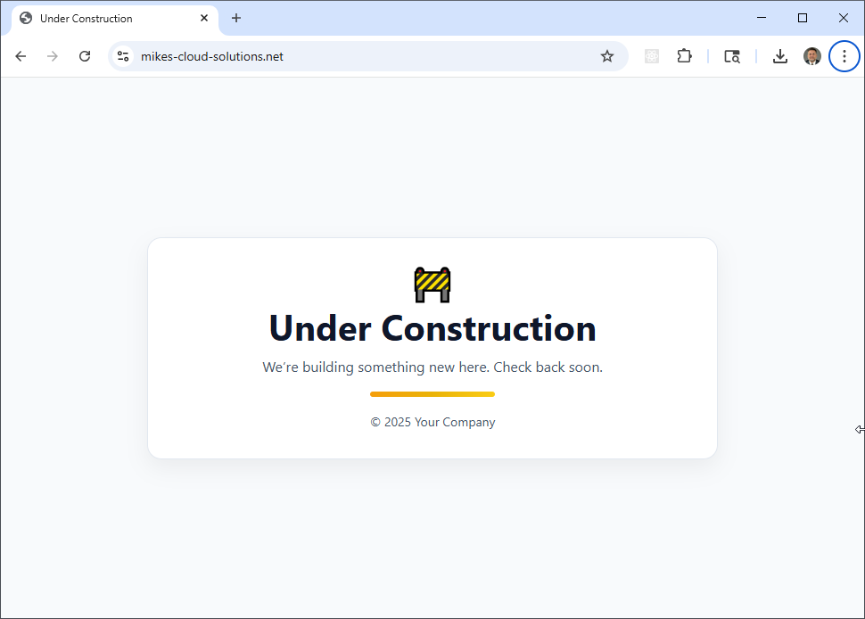
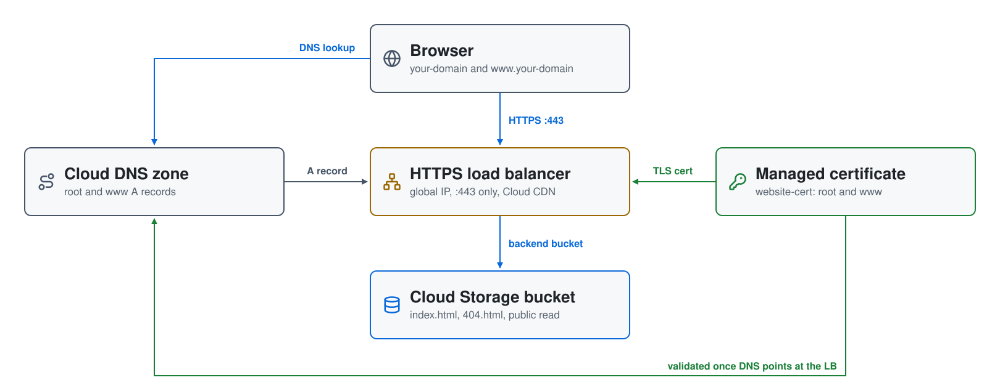

# Static Website on GCP: Cloud Storage + HTTPS Load Balancer

A static website built with Terraform: the content lives in a **Cloud
Storage** bucket, a **global external HTTPS load balancer** with **Cloud CDN**
serves it with a **Google-managed certificate**, and a **Cloud DNS** zone
points your domain and `www` at the load balancer. The only manual step is
registering the domain.



| Piece | Where | Role |
|---|---|---|
| **Cloud Storage bucket** | `US` multi-region | `<domain>-<hash>`: `index.html` and `404.html`; uniform access; public read (`allUsers` object viewer) |
| **HTTPS load balancer** | global | `website-ip` static address, `website-https-rule` on 443, `website-proxy`, `website-map`, and `website-backend`, a backend bucket with Cloud CDN |
| **Managed certificate** | global | `website-cert` for the domain and `www` |
| **Cloud DNS zone** | your zone | `A` records for the root and `www`, both pointing at `website-ip` |

## Architecture

<picture>
  <source media="(prefers-color-scheme: dark)" srcset="architecture-dark.svg">
  
</picture>

Regenerate with `python3 make_diagram.py`.

**`01-website/`** is the whole stack: `bucket.tf` (the bucket, the two pages
and public read), `loadbalancer.tf` (address, backend bucket, URL map,
certificate, proxy and forwarding rule), and `dns.tf` (the two `A` records).

## Prerequisites

* A registered domain with a Cloud DNS zone, from Cloud Domains or another
  registrar; the video walks through this step.
* [A Google Cloud Account](https://console.cloud.google.com/)
* [Install gcloud CLI](https://cloud.google.com/sdk/docs/install)
* [Install Terraform](https://developer.hashicorp.com/terraform/install)
* [Install jq](https://jqlang.github.io/jq/download/)

Put a service account key in the repository root as `credentials.json`;
`check_env.sh` activates it, and `api_setup.sh` enables the APIs the build
needs. If this is your first time watching our content, we recommend
starting with this video:
[GCP + Terraform: Easy Setup](https://youtu.be/3spJpYX4f7I).

## Configure

Set your domain and its Cloud DNS zone in `01-website/variables.tf`; the
defaults are the author's:

| Variable | Default |
|---|---|
| `domain_name` | `mikes-cloud-solutions.net` |
| `zone_name` | `mikes-cloud-solutions-net` |

## Deploy

```bash
git clone https://github.com/mamonaco1973/gcp-website.git
cd gcp-website
./apply.sh
```

`apply.sh` ends by running `validate.sh`, which checks `website-cert` every
5 minutes until it's `ACTIVE`. Google only issues it once the `A` records
resolve to the load balancer, which can take a while after the first apply.

## Try it

Open `https://your-domain` or `https://www.your-domain`: the "Under
Construction" page from `01-website/index.html`. Any missing path returns
`404.html`.

## Troubleshooting

| Symptom | Fix |
|---|---|
| The certificate stays `PROVISIONING` | The zone must be authoritative (the registrar's name servers must match the zone's NS records), and both `A` records must resolve to `website-ip`. |
| `http://` doesn't load | Only port 443 has a forwarding rule; there's no HTTP listener or redirect. Use `https://`. |
| An updated page doesn't show | Cloud CDN caches it; invalidate the cache on `website-map` or wait for it to expire. |

## Teardown

```bash
./destroy.sh     # destroys everything Terraform built; the domain and DNS zone stay
```

## Notes

- The bucket is publicly readable, so its objects are also reachable through
  `storage.googleapis.com`, not only through the load balancer.
